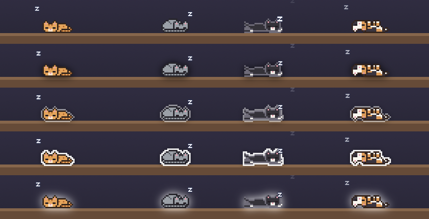
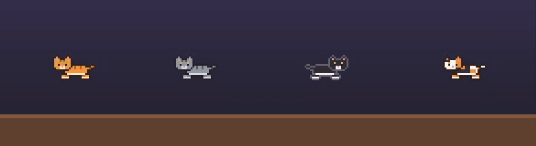
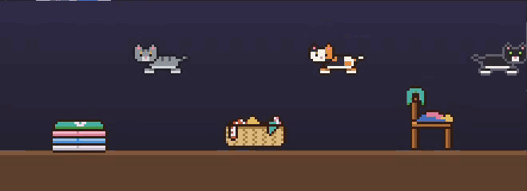
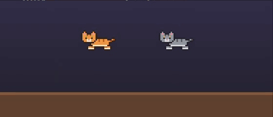
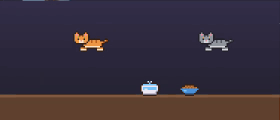

# Changelog

## Unreleased

### Easier to see

- "Stand out" in settings: a light ring and a soft shadow behind cats, furniture and toys, so they don't get lost among menu bar icons or on a bright wallpaper. Off, soft shadow, light sticker (the default), sticker or glow.

### Cats with character

- Cat character as data: habits, needs (company and curiosity), favourite nap spots, a daily routine and reactions to events, edited in the cat editor. The built-in personalities are presets that behave exactly as before.
- "About this cat": describe a real cat in your own words.
- Export and import cats as `.catprofile` files.
- Only the habits and nap spots that make a cat special are listed; add more from a menu. Many more nap spots, and a ★ for the very favourite.
- Rituals: little habits made of several steps, started by something that happens or by the time of day. Start from "After petting, follows you" and "Evening zoomies" in the cat editor; a `.catprofile` can describe any ritual.

### Naps

- New cosy furniture to nap in: an open box (only the ears peek out), a closed box to sleep on, a laundry basket, a wardrobe (with a top to climb onto) and a flower pot that gets squashed.
- Naps last longer and suit the cat: lazy cats sleep about a third of the time, playful ones about a tenth. The "Naps" habit sets how long a cat sleeps, not just how often.

- Four ways to sleep: tucked up like a loaf, curled up in a ball, stretched out on the belly, or belly up. Each cat varies, and can have a favourite ("Sleeps" in the cat editor). Sleepy cats yawn, and after a good nap they have a big stretch.

- Laundry: a stack of clean folded laundry and a chair piled with clothes to sleep on, and a wicker laundry basket to curl up in. A cat that sleeps on clean laundry leaves it covered in its fur, until you wash it (right-click it in furniture edit mode). Every cat is a little tempted by clean laundry.

### Play

- Rough and tumble: playful cats sometimes end a pounce in a cartoon fight cloud, a tumbling ball of dust in both cats' colours with paws, tails and ears sticking out and "#@!" flying, then dash off in a chase or sit down and wash as if nothing happened.

### Water

- A water fountain: cats get thirsty (more so after running about), go for a drink, lap with drops flying, then lick their lips or wash. It's in the furniture palette and in the default room next to the bowl. Rituals can use it too (`{ "drink": true }`).
- Some cats drink lying down, a paw round the fountain ("Drinks lying down by the fountain" in the cat editor), and some like to nap hugging it (a new favourite spot).

## 0.1.0

First public release.

- Pixel cats with personalities, moods, energy and hunger that walk, play, groom, sleep and greet each other.
- Petting, squishing, picking up and tossing cats with the mouse.
- Portal-style transit past the MacBook notch (idea by @nanot1m).
- Three worlds: menu bar only, whole screen above windows, desktop behind windows.
- Route planning over the menu bar, floor, shelves, window tops and desktop icons, with a jump "calculation" animation and the occasional missed jump.
- Furniture: shelves, scratching post, cat bed, food bowl, trash can, with an arrange mode.
- Toys: ball of yarn, laser pointer, butterflies.
- Cat editor with coat presets, custom colours, patterns, personality and size.
- English and Russian localisation.
