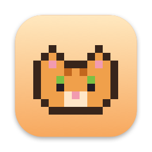
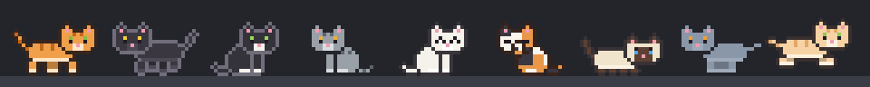

<p align="center">
  
</p>

<h1 align="center">Catification</h1>

<p align="center">
  Tiny pixel cats that live on your Mac's menu bar and all over your screen.<br>
  <b>English</b> · <a href="README.ru.md">Русский</a>
</p>

<p align="center">
  
</p>

Catification is a small native macOS app (Swift, AppKit, Core Animation) that turns your desktop into a home for pixel-art cats. They stroll along the menu bar, slip past the MacBook notch through Portal-style portals, climb shelves and scratching posts, and work out the trajectory before a big jump (sometimes they get it wrong).

## Features

- **Cats with personalities.** Playful, lazy, curious, affectionate or grumpy, each with its own energy, happiness and hunger. They walk, zoom around, groom, nap (often next to a friend), play chase and say hello to each other.
- **Pet them.** Move the cursor over a cat to pet it (it purrs and hearts fly), click to squish (don't overdo it), drag to pick it up and toss it.
- **Notch portals.** On MacBooks with a notch, cats walk into a blue portal on one side and come out of an orange one on the other.
- **Three worlds:** menu bar only; the whole screen above your windows (menu bar, shelves, the tops of other apps' windows, the bottom edge); or the desktop behind your windows.
- **Jump math.** Before a big jump a cat crouches, formulas float above its head (Δx, θ, √2gh, ∫ …) and a dotted parabola draws itself to the landing spot. Now and then it misjudges and ends up hanging off the edge.
- **Furniture you arrange yourself:** shelves, a scratching post (claw sharpening included), a cat bed, a food bowl (click to fill it), and a trash can to rummage in.
- **Toys:** a ball of yarn, a laser pointer and butterflies to hunt.
- **Make them yours:** name, coat preset or custom colours, pattern (solid, tabby, spotted, colorpoint), eye colour, personality and size, with a live preview.
- **Pixel art made in code.** All sprites are built from ASCII-art parts and recoloured per cat, so the app ships no image assets.
- **Localised:** English and Russian.

## Install

1. Download the latest `Catification-<version>-macos-universal.zip` from [Releases](../../releases).
2. Unzip it and move `Catification.app` to `/Applications`.
3. Open it. The app is free and open source but not notarized by Apple, so the first launch is blocked:
   - open **System Settings → Privacy & Security**, scroll down and click **Open Anyway** next to Catification, then confirm; **or**
   - run `xattr -dr com.apple.quarantine /Applications/Catification.app` in Terminal.
4. Look for the cat face in the menu bar. That's where the menu and settings live.

Requires macOS 13 Ventura or later, on Apple silicon or Intel.

### Permissions and privacy

Catification never connects to the network and collects nothing. Everything stays in the app's local preferences.

- To let cats walk on top of other windows it reads window positions (no permission needed; window titles and contents are never read).
- Climbing desktop icons is optional and needs **Accessibility** access, which macOS asks for when you turn it on.

## Build from source

You need Xcode 15 or later (or the Swift 5.9+ toolchain).

```bash
git clone https://github.com/Nikolsi/catification.git
cd catification
make run        # builds build/Catification.app and launches it
make test       # runs the unit tests
make sprites    # renders every animation of every coat into .preview/sprites.png
```

Handy flags: `Catification --settings` opens the settings window on launch, and `CATIFICATION_DEBUG=1` makes cats log what they are doing to stderr.

## How it works

- **`Art/`:** sprites are assembled from ASCII parts (head, body, legs, tail) with automatic outlines; a per-cat palette recolours them. Also a tiny pixel font for the jump formulas, furniture, emotes, the app icon and the README banner.
- **`World/CatWorld.swift`:** one transparent, click-through panel above the menu bar that runs at 60 fps. It only catches the mouse while the cursor is over a cat or a toy.
- **`World/Cat.swift`:** the cat's state machine: decisions, routes, jumps, play, eating, rummaging and hunting.
- **`World/Surfaces.swift` and `World/Navigator.swift`:** everything a cat can stand on (menu bar, floor, shelves, visible window tops, desktop icons) and a Dijkstra planner over jumps between them, with real ballistics.
- **`UI/`:** SwiftUI settings and the furniture palette.

## Roadmap

- Sprite source files and PNG import/export, so artists can contribute with Aseprite or Pixelorama.
- A small landing page, and more languages for the app and docs.
- Optional AI-driven moods and behaviours (local models or your own API key).
- Windows version.
- iOS "cat room" app and a Dynamic Island companion.

Ideas and bug reports are welcome in [Issues](../../issues).

## Contributing

See [CONTRIBUTING.md](CONTRIBUTING.md). Translations are especially welcome.

## License

[MIT](LICENSE) © Nikolai Arso
