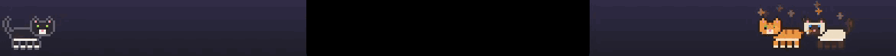
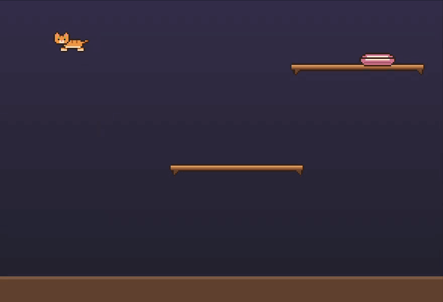
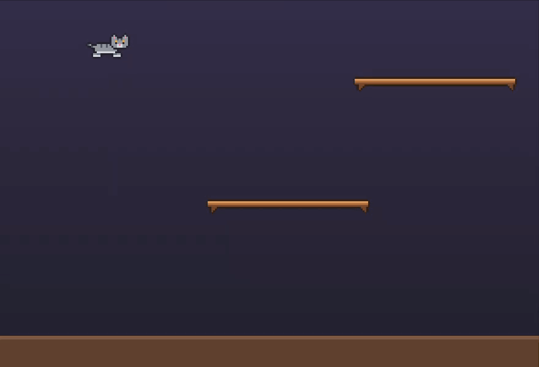
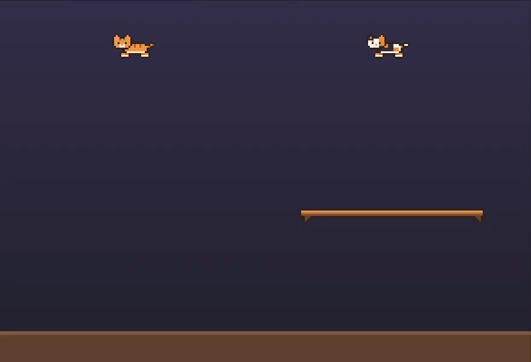
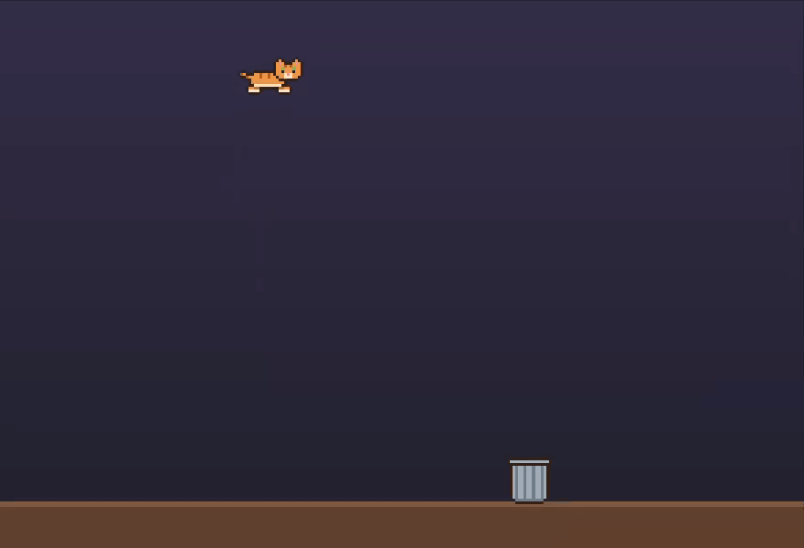
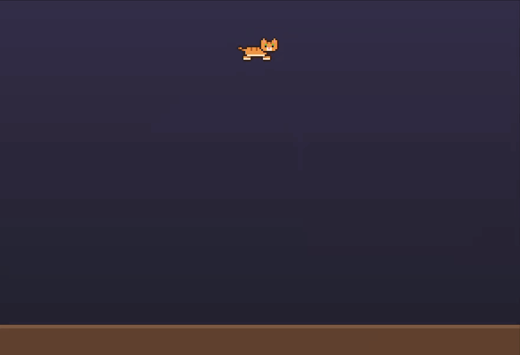
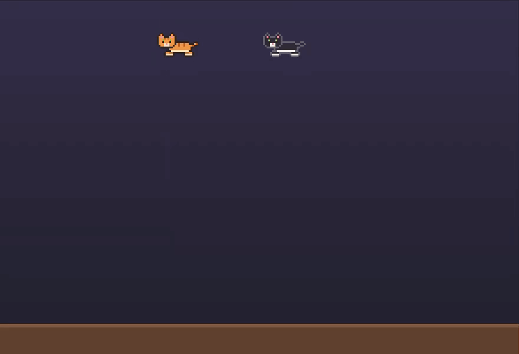
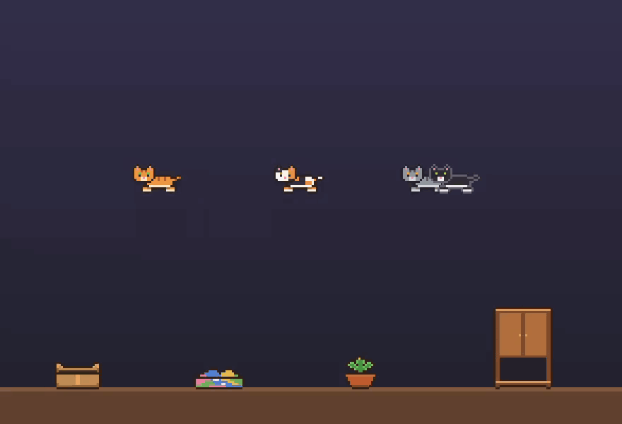

<p align="center">
  
</p>

<h1 align="center">Catification</h1>

<p align="center">
  Маленькие пиксельные котики, которые живут в меню-баре и по всему экрану Mac.<br>
  <a href="README.md">English</a> · <b>Русский</b>
</p>

<p align="center">
  
</p>

Catification — небольшое нативное приложение для macOS (Swift, AppKit, Core Animation), которое превращает рабочий стол в дом для пиксельных котиков. Они гуляют по меню-бару, проходят мимо чёлки MacBook через порталы в духе Portal, лазают по полкам и когтеточке и перед большим прыжком считают траекторию (иногда ошибаются).

## Как это выглядит

<table>
  <tr>
    <td colspan="2" align="center"><br><sub>Мимо чёлки через порталы · идея <a href="https://github.com/nanot1m">@nanot1m</a></sub></td>
  </tr>
  <tr>
    <td align="center"><br><sub>Сначала посчитать прыжок</sub></td>
    <td align="center"><br><sub>…и иногда ошибиться</sub></td>
  </tr>
  <tr>
    <td align="center"><br><sub>Охота на бабочек</sub></td>
    <td align="center"><br><sub>Шебуршит в мусорке</sub></td>
  </tr>
  <tr>
    <td align="center"><br><sub>Гладим (и жмякаем)</sub></td>
    <td align="center"><br><sub>Догонялки</sub></td>
  </tr>
  <tr>
    <td colspan="2" align="center"><br><sub>У каждого своё любимое место для сна</sub></td>
  </tr>
</table>

## Возможности

- **Котики с характером.** Игривый, ленивый, любопытный, ласковый или вредный, у каждого своя энергия, счастье и голод. Гуляют, носятся, умываются, спят (часто рядом с другом), играют в догонялки и здороваются друг с другом.
- **Их можно гладить.** Проведите курсором по котику, чтобы погладить (замурчит, полетят сердечки). Клик — жмяк (не переусердствуйте). Перетащите, чтобы взять на ручки и подбросить.
- **Порталы у чёлки.** На MacBook с чёлкой котик заходит в синий портал с одной стороны и выходит из оранжевого с другой.
- **Три мира:** только меню-бар; весь экран поверх окон (меню-бар, полки, верхушки окон других приложений, низ экрана); рабочий стол за окнами.
- **Математика прыжков.** Перед большим прыжком котик приседает, над головой всплывают формулы (Δx, θ, √2gh, ∫…), а пунктир параболы прорисовывается до места приземления. Иногда котик промахивается и повисает на краю.
- **Мебель, которую вы расставляете сами:** полки, когтеточка (точит когти), лежанка, миска (клик насыпает корм), мусорка, в которой можно порыться, и уютные места для сна: открытая коробка, закрытая коробка, на которой можно спать, гора вещей, шкаф с открытой нижней полочкой и цветочный горшок (цветок сплющивается).
- **Игрушки:** клубок, лазерная указка и бабочки для охоты.
- **Свои котики:** имя, готовый окрас или свои цвета, узор (однотонный, полосатый, пятнистый, колор-пойнт), цвет глаз, характер и размер, с живым превью.
- **Ваш настоящий котик.** Опишите его и настройте характер: повадки (роется в мусорке, спит, приходит за лаской…), любимые места для сна, распорядок дня и реакции на события. Котиками можно делиться через файлы `.catprofile`.
- **Пиксель-арт из кода.** Все спрайты собираются из ASCII-частей и перекрашиваются под каждого котика, поэтому картинок в приложении нет.
- **Языки:** английский и русский.

## Установка

1. Скачайте последний `Catification-<версия>-macos-universal.zip` из [Releases](../../releases).
2. Распакуйте и перенесите `Catification.app` в «Программы».
3. Откройте. Приложение бесплатное и открытое, но не нотаризовано Apple, поэтому первый запуск заблокируется:
   - откройте **Системные настройки → Конфиденциальность и безопасность**, прокрутите вниз и нажмите **Всё равно открыть** рядом с Catification, затем подтвердите; **или**
   - выполните в Терминале `xattr -dr com.apple.quarantine /Applications/Catification.app`.
4. Найдите мордочку котика в меню-баре: там меню и настройки.

Нужна macOS 13 Ventura или новее, Apple silicon или Intel.

Язык интерфейса берётся из системы. Чтобы включить русский только для Catification: **Системные настройки → Основные → Язык и регион → Приложения**.

### Разрешения и приватность

Catification не ходит в сеть и ничего не собирает. Всё хранится в локальных настройках приложения.

- Чтобы котики гуляли по верхушкам других окон, приложение читает положение окон (без разрешений; заголовки и содержимое окон не читаются).
- Лазать по иконкам рабочего стола — по желанию. Для этого нужен **Универсальный доступ**, macOS спросит его при включении.

## Сборка из исходников

Нужен Xcode 15 или новее (или Swift 5.9+).

```bash
git clone https://github.com/Nikolsi/catification.git
cd catification
make run        # собрать build/Catification.app и запустить
make test       # юнит-тесты
make sprites    # отрендерить все анимации всех окрасов в .preview/sprites.png
make demos      # перезаписать гифки выше (нужен ffmpeg)
```

Полезное: `Catification --settings` сразу открывает настройки, а с `CATIFICATION_DEBUG=1` котики пишут в stderr, чем заняты.

## Как устроено

- **`Art/`:** спрайты собираются из ASCII-частей (голова, тело, лапы, хвост) с автоматическим контуром, палитра котика их перекрашивает. Там же пиксельный шрифт для формул, мебель, эмоции, иконка и баннер для README.
- **`World/CatWorld.swift`:** одна прозрачная панель поверх меню-бара, 60 кадров в секунду. Мышь она ловит, только когда курсор над котиком или игрушкой.
- **`World/Cat.swift`:** поведение котика: маршруты, прыжки, игры, еда, мусорка и охота.
- **`Brain/`:** характер котика как данные (повадки, потребности, любимые места, распорядок, реакции) и планировщик, который выбирает, чем котик займётся. Без всякого ИИ.
- **`World/Surfaces.swift` и `World/Navigator.swift`:** всё, на чём можно стоять (меню-бар, пол, полки, видимые верхушки окон, иконки), и планировщик прыжков между ними (Дейкстра и настоящая баллистика).
- **`UI/`:** настройки на SwiftUI и палитра мебели.

## Планы

- Исходники спрайтов в файлах и импорт/экспорт PNG, чтобы художники могли помогать через Aseprite или Pixelorama.
- Небольшой лендинг и больше языков для приложения и документации.
- По желанию — настроения и поведение на ИИ (локальные модели или свой ключ API).
- Версия для Windows.
- iOS-приложение «котокомната» и котик в Dynamic Island.

Баги и предложения — в [Issues](../../issues), вопросы, идеи и скриншоты ваших котиков — в [Discussions](../../discussions).

## Участие

См. [CONTRIBUTING.md](CONTRIBUTING.md) (на английском). Особенно рады переводам.

## Лицензия

[MIT](LICENSE) © Nikolai Arso
